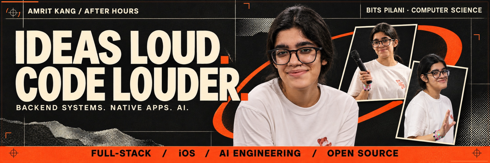
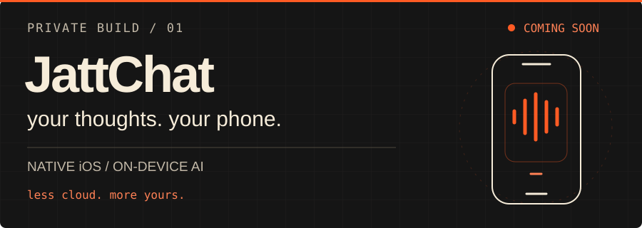
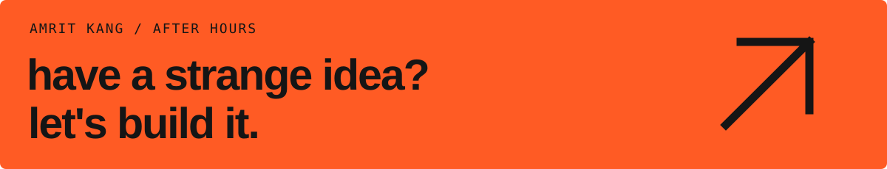

  <picture>
    <source media="(prefers-reduced-motion: reduce)" srcset="assets/after-hours/amrit-hero-effects.jpg" />
    
  </picture>

**[portfolio ↗](https://amritkang.vercel.app)** &nbsp; / &nbsp; **[linkedin ↗](https://www.linkedin.com/in/amritkang28/)** &nbsp; / &nbsp; **[say hello ↗](mailto:amritkang2805@icloud.com)**

[open source](#open-source) · [the lab](#the-lab) · [selected builds](#selected-builds) · [track record](#track-record) · [off the clock](#off-the-clock)

 

i'm **amrit**, a second-year computer science student at **BITS Pilani**, based in Bengaluru. i build backends, native apps, and AI tools. sometimes i pick up a mic and bring builders into the same room.

*the idea usually arrives at 2am. the commit history can explain the rest.*

| BACKEND & SYSTEMS | NATIVE & WEB |
| :--- | :--- |
| Python · Go · FastAPI · AWS · Docker | Swift · SwiftUI · React · Next.js · TypeScript |
| **AI ENGINEERING** | **THE PART BETWEEN** |
| LLM APIs · agents · retrieval · structured outputs | databases · system design · deployment · developer tooling |

 

## 01 / open source

**small fixes count. so does making someone else's tool easier to use.**

### Flisk · developer experience

added a JSON Schema for `service.json`, giving service manifests editor guidance and validation. covered legacy fields and resource types, wired up generated manifests, and added contract tests to catch schema drift.

**[merged PR #416 ↗](https://github.com/flisk-sh/flisk/pull/416)** · JSON Schema · service configuration · contract testing

added `flisk open --print` so scripts and SSH sessions can get a ready frontend URL without launching a browser. covered URL selection, failure cases, and local-process projects with regression tests.

**[merged PR #3623 ↗](https://github.com/flisk-sh/flisk/pull/3623)** · TypeScript · CLI · regression testing

also added tests for documentation text-width calculations, covering Unicode, fallback widths, and rounding.

**[merged PR #3535 ↗](https://github.com/flisk-sh/flisk/pull/3535)** · JavaScript · unit testing

### Neo.mjs · lifecycle reliability

fixed delayed callbacks running after an instance was destroyed. pending buffer, debounce, and throttle calls are now cancelled during cleanup, with regression tests for inherited methods, wrapper reuse, and grid destruction during scrolling.

**[merged PR #20723 ↗](https://github.com/neomjs/neo/pull/20723)** · JavaScript · lifecycle cleanup · regression testing

### iffy.ai · interactive simulations

made “what if?” results explorable: interactive flowcharts, branching simulations, and saved simulation history. contributed UI improvements and fixes across the frontend and debate backend.

**[flowcharts + branching ↗](https://github.com/Muneer320/iffy-ai/commit/03c2909bb2b878792cd894aee1f07b66ed28e5f6)** · **[history + fixes ↗](https://github.com/Muneer320/iffy-ai/commit/dc9e93cb8da958b7140f45c33523343a1c7d251a)** · Next.js · TypeScript

 

## 02 / the lab

**one private build. a little signal before the reveal.**

<!-- Public teasers only: no private repository links or unreleased source. -->

what if your AI conversation never needed to leave your iPhone? **JattChat** is my exploration of native, on-device chat: local responses, locally saved conversations, and no external AI API in the loop.

<b>the interesting bit ↗</b>

 

the model lives on the device, so the engineering starts with a different question: *is this phone actually ready to run it?* i'm working with Apple's Foundation Models, SwiftUI, and SwiftData to make availability checks, conversation state, and local persistence part of the experience.

**private build · coming soon** — on compatible iPhones with the system model available.

 

## 03 / selected builds

**the things behind the commit messages.** open a build for the engineering notes.

<b>MERAWARD</b> / civic complaints, with a route to action

 

drop a pin, find your Delhi ward, file a complaint by voice, photo, or text, and get an AI-drafted bilingual letter. a public neglect-index dashboard makes the wider picture visible.

i led the team and built the frontend and ward pipeline at First Commit. decoupling Bedrock behind SQS brought the reported API response to **~2 ms**; the project has **254 tests** and a **100 Lighthouse score**.

`AWS Lambda` `Bedrock` `DynamoDB` `SQS` `React` `MapLibre`

**[source ↗](https://github.com/amritkang165/meraward)** · **[live ↗](https://main.d1s6q0cvldi6dz.amplifyapp.com/)**

<b>ReGit</b> / research deserves more than a text diff

 

version control for PDFs, documents, LLM chats, and codebases. content-addressed commits, semantic diffs, 3-way prose merge, CRDT collaboration, and hybrid BM25 + vector retrieval — offline, in a single process.

**120 tests** covering convergence and merge conflicts · **top 6, Gradient Rush Hackathon**.

`Python` `FastAPI` `React` `pycrdt` `yjs`

**[source ↗](https://github.com/amritkang165/ReGit)** · **[live ↗](https://regit.vercel.app/)**

<b>Pocki</b> / a payment screenshot becomes an expense

 

a native iOS finance tracker that reads screenshots from GPay, PhonePe, Paytm, BHIM, and Amazon Pay. no manual transaction entry; parsing and storage stay on the phone.

**offline-first · MIT-licensed · open source.**

`Swift 6` `SwiftUI` `SwiftData` `Vision`

**[source ↗](https://github.com/amritkang165/Pocki)**

<b>Placement Week Scheduler</b> / when one late interview breaks the plan

 

a CP-SAT solver for **800 students, 35 companies, 20 rooms, and 1,123 shortlists**. it reaches **99.5% interview coverage**, zero clashes, and 90% room utilization.

the more interesting problem is replanning: when something changes, re-solve only the affected slice. the disruption-aware replanner touched **1.4% of appointments** in the reported scenario. **45 tests.**

`Python` `OR-Tools` `FastAPI` `React`

**[source ↗](https://github.com/amritkang165/placement-week-scheduler)**

<b>more experiments</b> / agents, graphs, wardrobes, and a terminal pet

 

- **[exHacker](https://github.com/amritkang165/exHacker)** — a 7-agent pipeline from hackathon problem statement to pitch-ready package. `LangGraph` `FastAPI` `Next.js`
- **[iffy.ai](https://github.com/amritkang165/iffy-ai)** — a typed consequence graph for “what if?” questions. i built the frontend; top 7 finalist at ProdX @ NAVERA 26. `React` `TypeScript`
- **[WearWise](https://github.com/amritkang165/wearwise)** — an AI wardrobe manager, because owning clothes and knowing what to wear are different problems. `Next.js` `Prisma`
- **[Gitty](https://github.com/amritkang165/gitty)** — GitHub in your pocket, with search, trending repos, and developer tools. `React Native`
- **[TintAudit](https://github.com/amritkang165/TintAudit)** — browser-based contrast analysis in Swift compiled to WebAssembly. yes, really. `Swift` `WASM`
- **[Oratio](https://github.com/amritkang165/Oratio)** — voice-enabled AI debate with real-time transcription and LCR-based judging. `WebSockets` `LLM APIs`
- **[LaunderLens](https://github.com/amritkang165/Launder-Lens)** — graph-based fraud detection for circular fund routing and smurfing; reported 92% accuracy across 1,000+ transactions. `Node.js`
- **[Gotermi](https://github.com/amritkang165/Gotermi)** — a terminal pet that watches your coding habits and reacts. `Go`

 

## 04 / track record

- **Grabware / SDE & Forward Deployed Engineer Intern** — May 2026–present. hosting, deployment, and infrastructure for 15+ production PHP sites; migrated a subset to MERN and tested the integrations.
- **BITS Pilani / B.Sc. Computer Science** — 2025–2029 · CGPA **9.27**.
- **Gradient Rush / top 6** — ReGit, a research version-control system.
- **ProdX @ NAVERA 26 / top 7 finalist** — frontend for iffy.ai.
- **Hack Club / Bengaluru organizer** — Sunbeam, a global initiative spanning 40 cities.
- **Ignite Room / events lead** — venues, volunteers, speakers, and making the room happen.

 

## 05 / off the clock

Apple platform deep dives. system design. agents and evals. *Designing Data-Intensive Applications*. community events that start as a group chat and somehow become a real room.

<b>one more thing ↗</b>

 

if you're building something useful, strange, or slightly over-engineered, we'll probably get along.

fun fact — I'm Jatt.

**[send a hello](mailto:amritkang2805@icloud.com)** · **[read my posts](https://dev.to/amritkang165)** · **[AWS Builder profile](https://builder.aws.com/profile/jattkang)**

 

